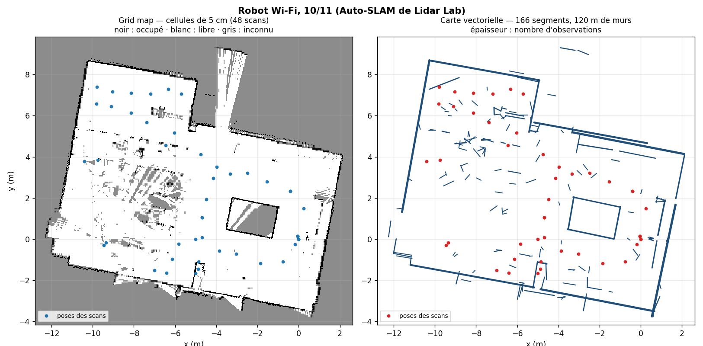

# carto — cartographie et localisation 2D avec un lidar LD06

Bibliothèque Python et interface **Lidar Plot** pour transformer les scans d'un lidar LD06 en cartes
(grid map et carte vectorielle) et pour localiser un robot par **scan matching**, avec un banc
d'évaluation chiffrée. Projet réalisé dans le cadre du module « Cartographie et localisation appliquée
à la robotique mobile ».

Ce dépôt est l'**outil 1** du projet. L'**outil 2**, Lidar Lab (application web reliée au robot,
SLAM en direct, exploration automatique), est dans un dépôt séparé ([bookineur/lidar-lab](https://github.com/bookineur/lidar-lab)) ; les deux outils partagent les
mêmes formats de fichiers.



## Rendu du TP

> **Rapport final : [RENDU_FINAL/rapport_final_TP_cartographie.pdf](RENDU_FINAL/rapport_final_TP_cartographie.pdf)**
>
> Vidéos : [localisation d'un scan](RENDU_FINAL/video/demo_localisation_scan.mp4) ·
> [exploration automatique (bonus)](RENDU_FINAL/video/exploration_automatique_demo.mp4) ·
> Outil 2 : [Lidar Lab](https://github.com/bookineur/lidar-lab) ·
> Robot : [ESP32_robot_wifi_v5](arduino/ESP32_robot_wifi_v5) ·
> Tout le rendu : [dossier RENDU_FINAL](RENDU_FINAL)

## Fonctionnalités

| Domaine | Ce que fait le code | Module |
|---|---|---|
| Acquisition | Lecture du LD06 (paquets de 47 octets), formats CSV / Teleplot, correction du sens de rotation | `carto/scan.py`, `arduino/` |
| Visualisation | Lidar Plot : scans en direct, plusieurs scans superposés, une couleur par scan, pose éditable | `carto/plot_app.py`, `carto/viewer.py` |
| Grid map | Carte d'occupation en log-odds (rayons *supercover*), création et mise à jour, durée de vie des cellules | `carto/gridmap.py` |
| Segments | Extraction (split-and-merge), angle, proximité, fusion, intersection, découpe avec cas limites | `carto/segments.py` |
| Carte vectorielle | Fusion scan après scan, découpe par les rayons, filtrage par nombre d'observations | `carto/vectormap.py`, `carto/build_map.py` |
| Recalage | Scans à positions inconnues : recherche globale par FFT sur 360°, puis ICP | `carto/register.py` |
| Localisation | 7 méthodes (brute force, multi-résolution, Gauss-Newton, ICP, particules, 2 calculs directs) sur 3 références (grid map, carte vectorielle, scan) | `carto/localisation.py` |
| Localisation globale | Retrouver la pose d'un scan sans pose initiale | `carto/localisation_globale.py` |
| Évaluation | Mêmes scans et poses initiales pour toutes les méthodes : erreurs, temps, taux de réussite, sensibilité | `carto/evaluation.py` |

## Démarrage rapide

```bash
pip install -r requirements.txt      # Python 3.10 ou plus récent
python -m pytest                     # 65 tests automatiques
python -m carto plot                 # Lidar Plot
python -m carto assemble data/salle_2026-11-02_18h31     # cartes d'une séance -> carte/version_N
python -m carto evaluer --rapide     # banc d'évaluation de la localisation
```

Autres commandes : `python -m carto --help` (`grid`, `vector`, `view`, `localiser`, `simulate`, `assistant`).

## Résultats principaux

| Expérience | Résultat |
|---|---|
| Localisation, simulation (vérité connue) | Gauss-Newton sur carte vectorielle : 4 mm et 0,06° en 6 ms |
| Localisation, scans réels | 1,5 à 3 cm ; multi-résolution et particules fiables jusqu'à 50 cm / 20° d'erreur initiale |
| Localisation globale (48 scans réels, sans pose initiale) | Grid map : 42 retrouvés, 0 fausse pose ; carte vectorielle : 47 retrouvés, 0 fausse pose |
| Cartes des séances réelles | 02/11, 03/11, 04/11 et 10/11 : `resultats/cartes_seances/` |

Les protocoles et les critères de réussite sont écrits et committés **avant** chaque mesure ; les
résultats bruts (CSV, JSON) sont gardés à côté des synthèses dans `resultats/`.

## Structure du dépôt

```
carto/        bibliothèque et interfaces (voir le tableau ci-dessus)
tests/        tests automatiques (pytest)
arduino/      programmes de l'ESP32 et du LD06 (ESP32_robot_wifi_v5 : version de référence)
data/         scans réels et simulés, séances du robot (jamais modifiés ; les calculs écrivent ailleurs)
resultats/    évaluations, cartes des séances, démonstrations
rendu/        comptes rendus, protocoles, fiches d'essai, rapport final
docs/         guide d'utilisation détaillé
```

## Documentation

- [Guide d'utilisation détaillé](docs/GUIDE_UTILISATION.md) : protocole du LD06, capture, Lidar Plot,
  construction des cartes, localisation, séances avec le robot.
- [Programmes de l'ESP32](arduino/README.md).
- Rapport final : `rendu/rapport_final/`.

## Données

Les scans sont au format CSV `angle_deg,distance_mm,intensity` (un tour du lidar par fichier) ; les
poses au format JSON `{"scan1": [x_m, y_m, theta_deg]}`. Les identifiants Wi-Fi du robot ne sont
jamais versionnés (`arduino/**/wifi_secrets.h` est ignoré par Git).
