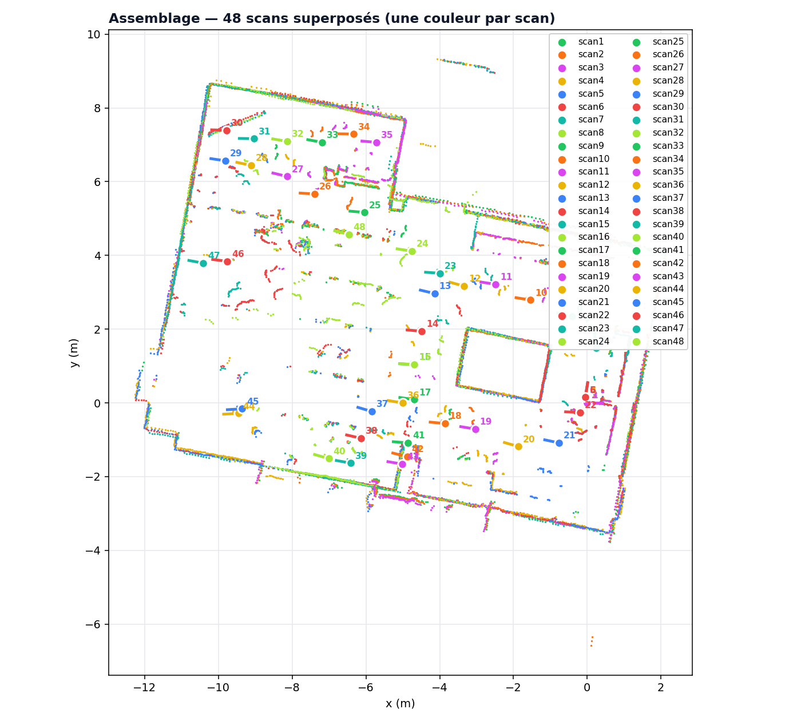
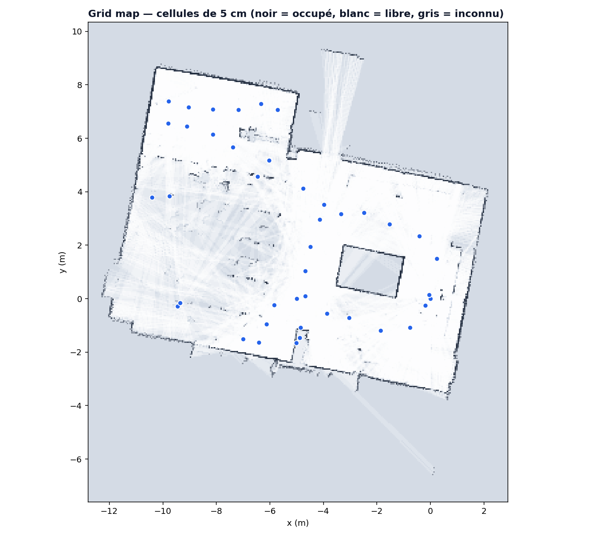
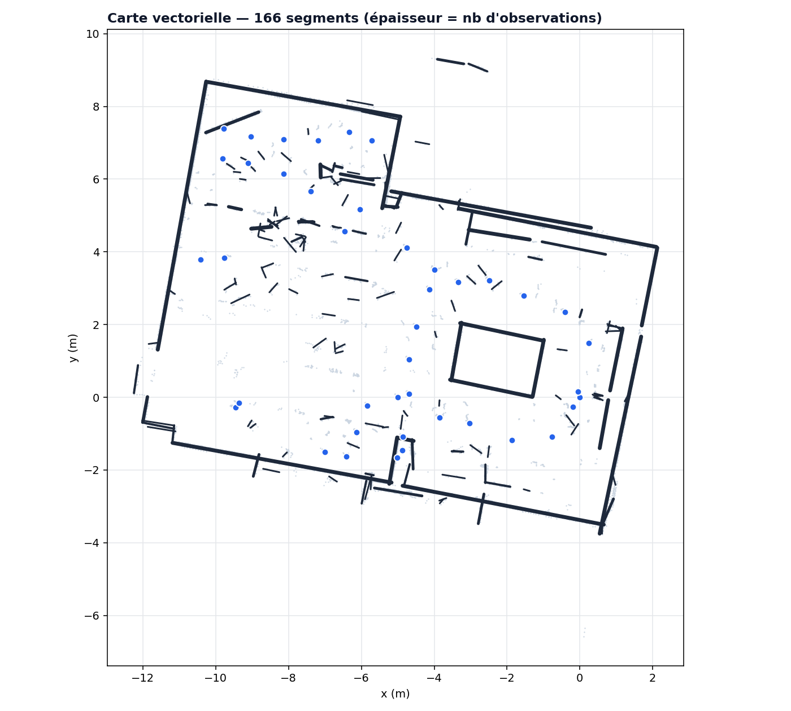

# Cartographie de la pièce — grid map et carte vectorielle

Généré le 10/11/2026 14:20.

## 1. Données

Scans utilisés : scan1, scan2, scan3, scan4, scan5, scan6, scan7, scan8, scan9, scan10, scan11, scan12, scan13, scan14, scan15, scan16, scan17, scan18, scan19, scan20, scan21, scan22, scan23, scan24, scan25, scan26, scan27, scan28, scan29, scan30, scan31, scan32, scan33, scan34, scan35, scan36, scan37, scan38, scan39, scan40, scan41, scan42, scan43, scan44, scan45, scan46, scan47, scan48. 

Chaque scan est un tour du LD06 : environ 450 points (angle, distance) à 10 tr/s, plus de 1 000 points quand le lidar tourne plus lentement. Les scans ont été reçus au format Teleplot (`printScanTeleplot`), qui transmet x et y mais **pas l'intensité**.

## 2. Prétraitement (§2 du document)

- points à moins de 10 cm (boîtier, câbles) ou à plus de 10 m (précision dégradée) supprimés ;
- points **isolés** supprimés (moins de 2 voisins à moins de 15 cm) : reflets, poussières, mesures aberrantes ;
- intensité < 50 supprimée.

Bilan : 19281 points bruts → 14315 points conservés.

| scan | points bruts | conservés | sur des murs (segments ≥ 60 cm) | utilisé |
|---|---|---|---|---|
| scan1 | 394 | 321 | 63% | oui |
| scan2 | 394 | 322 | 61% | oui |
| scan3 | 394 | 315 | 59% | oui |
| scan4 | 395 | 300 | 58% | oui |
| scan5 | 395 | 300 | 60% | oui |
| scan6 | 395 | 307 | 60% | oui |
| scan7 | 396 | 276 | 47% | oui |
| scan8 | 395 | 271 | 65% | oui |
| scan9 | 397 | 266 | 59% | oui |
| scan10 | 395 | 283 | 61% | oui |
| scan11 | 395 | 279 | 47% | oui |
| scan12 | 395 | 252 | 43% | oui |
| scan13 | 395 | 256 | 53% | oui |
| scan14 | 394 | 245 | 64% | oui |
| scan15 | 397 | 244 | 58% | oui |
| scan16 | 397 | 248 | 57% | oui |
| scan17 | 397 | 239 | 57% | oui |
| scan18 | 395 | 270 | 52% | oui |
| scan19 | 395 | 291 | 73% | oui |
| scan20 | 394 | 295 | 63% | oui |
| scan21 | 395 | 294 | 74% | oui |
| scan22 | 394 | 296 | 52% | oui |
| scan23 | 395 | 269 | 55% | oui |
| scan24 | 394 | 252 | 48% | oui |
| scan25 | 396 | 299 | 53% | oui |
| scan26 | 396 | 315 | 42% | oui |
| scan27 | 396 | 327 | 61% | oui |
| scan28 | 396 | 311 | 66% | oui |
| scan29 | 397 | 324 | 70% | oui |
| scan30 | 698 | 626 | 69% | oui |
| scan31 | 395 | 323 | 73% | oui |
| scan32 | 395 | 340 | 72% | oui |
| scan33 | 396 | 329 | 69% | oui |
| scan34 | 395 | 360 | 70% | oui |
| scan35 | 398 | 380 | 71% | oui |
| scan36 | 395 | 249 | 36% | oui |
| scan37 | 402 | 267 | 58% | oui |
| scan38 | 395 | 298 | 65% | oui |
| scan39 | 396 | 320 | 72% | oui |
| scan40 | 394 | 306 | 68% | oui |
| scan41 | 394 | 233 | 70% | oui |
| scan42 | 394 | 236 | 71% | oui |
| scan43 | 395 | 245 | 78% | oui |
| scan44 | 393 | 291 | 67% | oui |
| scan45 | 394 | 277 | 80% | oui |
| scan46 | 396 | 355 | 55% | oui |
| scan47 | 396 | 302 | 77% | oui |
| scan48 | 397 | 311 | 46% | oui |

## 3. Assemblage des scans (superposition dans un repère commun)

Les positions du robot n'ayant pas été mesurées, elles ont été retrouvées par **recalage** :

**Scan matching successif** (cours : « Lidar – scan matching successif » et « processus général de cartographie ») :

1. le premier scan fixe le repère de la carte (pose 0, 0, 0) ;
2. chaque scan suivant, dans l'ordre de capture, est recalé sur le scan précédent : pour chaque rotation de 0 à 360° (pas de 2°), la translation est cherchée par corrélation (« correlative scan matching »), puis affinée par **ICP** ;
3. la pose obtenue est affinée par ICP sur la carte déjà construite, puis les points du scan sont ajoutés à la carte ;
4. un recalage est refusé si le **recouvrement** (part des points à moins de 10 cm de la référence) est trop faible ou s'il est **ambigu** (une rotation nettement différente colle presque aussi bien, salle symétrique) : le cours demande d'éviter ces correspondances. On essaie alors les scans placés juste avant, ou on réessaie plus tard.

Formule appliquée à chaque point : P_global = R(θ)·P_local + T(x, y).

| scan | x (m) | y (m) | θ (°) | recouvrement avec les autres scans |
|---|---|---|---|---|
| scan1 | 0.00 | 0.00 | 0.0 | 99% |
| scan2 | 0.00 | 0.00 | 0.0 | 100% |
| scan3 | 0.00 | 0.00 | 0.0 | 100% |
| scan4 | -0.05 | 0.15 | 81.0 | 100% |
| scan5 | -0.05 | 0.15 | 81.0 | 100% |
| scan6 | -0.05 | 0.15 | 81.0 | 99% |
| scan7 | 0.24 | 1.49 | 96.0 | 95% |
| scan8 | -0.41 | 2.34 | 165.5 | 100% |
| scan9 | -0.41 | 2.34 | 166.0 | 100% |
| scan10 | -1.53 | 2.79 | 171.0 | 88% |
| scan11 | -2.48 | 3.21 | 171.0 | 92% |
| scan12 | -3.33 | 3.17 | 164.5 | 82% |
| scan13 | -4.13 | 2.96 | 166.5 | 87% |
| scan14 | -4.49 | 1.94 | 174.5 | 92% |
| scan15 | -4.68 | 1.04 | 177.0 | 94% |
| scan16 | -4.68 | 1.04 | 177.0 | 91% |
| scan17 | -4.68 | 0.09 | 172.0 | 91% |
| scan18 | -3.86 | -0.56 | 174.5 | 91% |
| scan19 | -3.04 | -0.71 | 170.5 | 94% |
| scan20 | -1.86 | -1.19 | 164.0 | 85% |
| scan21 | -0.76 | -1.08 | 168.0 | 87% |
| scan22 | -0.18 | -0.26 | 177.5 | 98% |
| scan23 | -3.98 | 3.52 | 176.0 | 97% |
| scan24 | -4.76 | 4.12 | 171.0 | 92% |
| scan25 | -6.04 | 5.17 | 175.0 | 94% |
| scan26 | -7.38 | 5.67 | 176.5 | 94% |
| scan27 | -8.13 | 6.14 | 166.5 | 91% |
| scan28 | -9.11 | 6.44 | 168.0 | 94% |
| scan29 | -9.81 | 6.57 | 171.5 | 95% |
| scan30 | -9.79 | 7.39 | 178.0 | 100% |
| scan31 | -9.04 | 7.17 | 179.0 | 97% |
| scan32 | -8.13 | 7.09 | 170.0 | 95% |
| scan33 | -7.18 | 7.07 | 169.5 | 96% |
| scan34 | -6.33 | 7.29 | 179.0 | 95% |
| scan35 | -5.71 | 7.07 | 175.0 | 93% |
| scan36 | -5.00 | 0.00 | 171.0 | 96% |
| scan37 | -5.83 | -0.23 | 163.5 | 95% |
| scan38 | -6.13 | -0.96 | 167.0 | 96% |
| scan39 | -6.41 | -1.64 | 169.5 | 98% |
| scan40 | -7.01 | -1.51 | 164.0 | 87% |
| scan41 | -4.86 | -1.08 | 175.5 | 100% |
| scan42 | -4.88 | -1.46 | 165.5 | 98% |
| scan43 | -5.01 | -1.66 | 170.5 | 99% |
| scan44 | -9.46 | -0.28 | -177.0 | 96% |
| scan45 | -9.36 | -0.16 | -176.5 | 98% |
| scan46 | -9.76 | 3.84 | 173.0 | 79% |
| scan47 | -10.41 | 3.79 | 169.5 | 88% |
| scan48 | -6.46 | 4.57 | 165.5 | 81% |

## 4. Grid map (carte d'occupation)

Cellules de 5 cm, log-odds : chaque rayon (Bresenham) rend libres les cellules traversées et occupée la cellule d'impact.

- surface libre : 107.3 m², occupée : 4.7 m²

## 5. Carte vectorielle (§3 et §4 du document)

- **segmentation** : rupture de cluster quand deux points successifs sont à plus de 20 cm ;
- **reconnaissance géométrique** : simplification polygonale (Douglas-Peucker, seuil 10 cm), puis droite des moindres carrés totaux sur chaque morceau ;
- **mise à jour** : un segment proche d'un segment existant (angle < 8°, écart latéral < 8 cm, trou < 20 cm) est **fusionné**, sinon **ajouté** ; chaque segment compte ses observations (confiance) ;
- **nettoyage** : segments de moins de 15 cm supprimés.

Résultat : 166 segments, dont 59 vus au moins 2 fois, 119.5 m de murs.

Fichier `carte_vectorielle.txt` : une ligne `x1,y1,x2,y2` par segment (format du document).

## 7. Limites

- pas d'intensité : les reflets et surfaces sombres ne peuvent pas être filtrés par qualité ;
- les positions sont estimées par recalage : une pièce très symétrique ou très encombrée peut donner un recalage faux (c'est pourquoi certains scans ont été écartés) ;
- le lidar voit dans un seul plan (hauteur du capteur) : tables, chaises et pieds de meubles apparaissent comme des points ou de petits segments ;
- objets mobiles (personnes) : vus dans un seul scan, ils donnent des segments à 1 observation.
