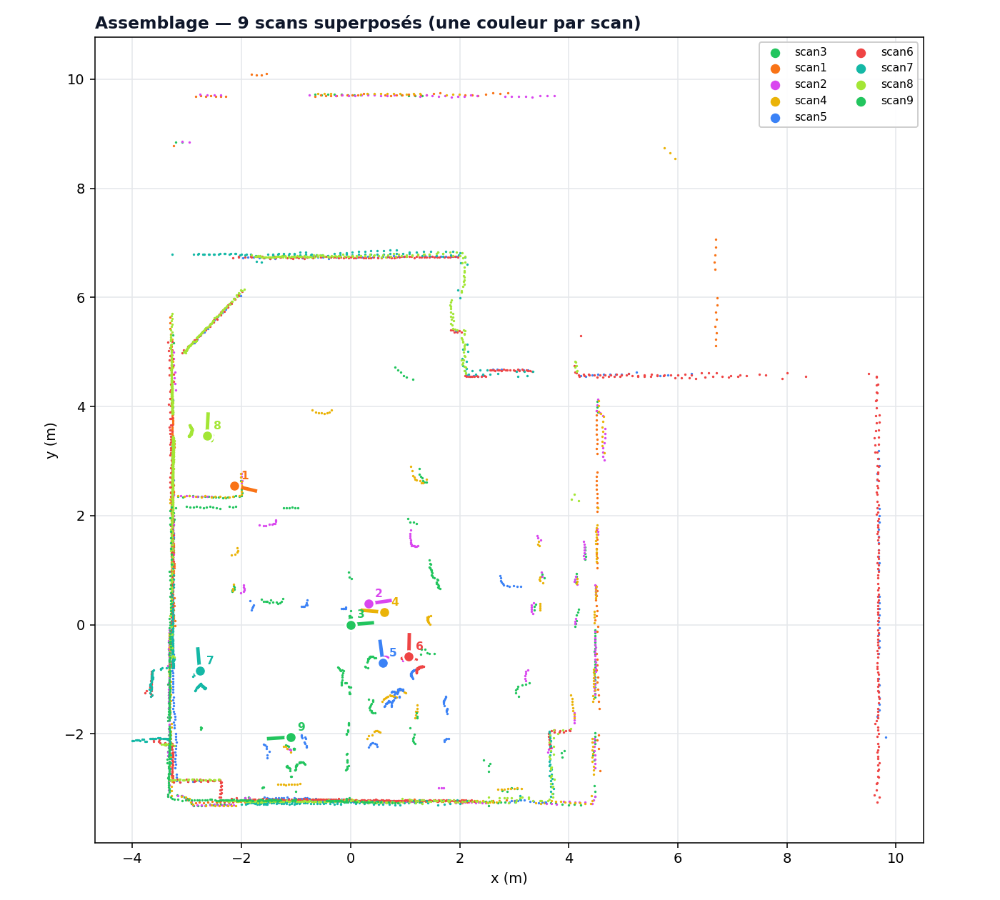
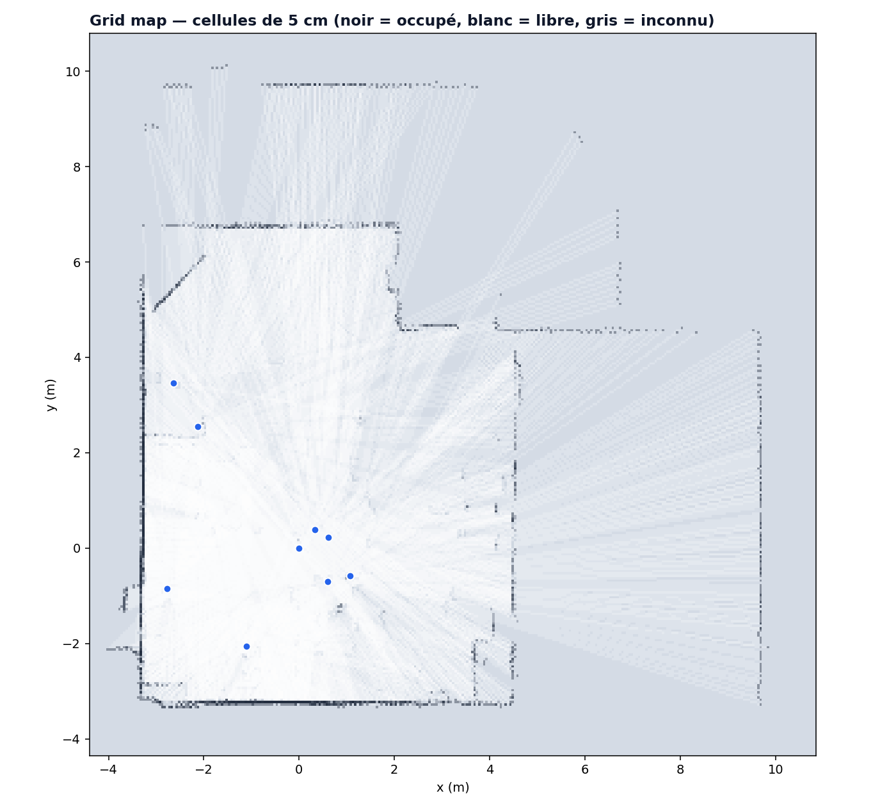
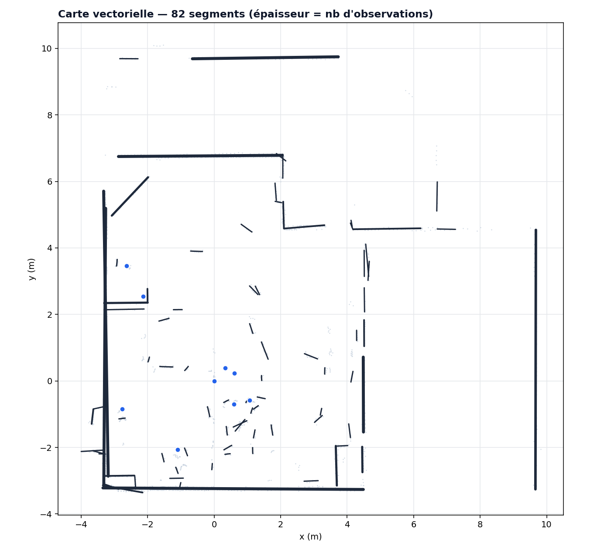
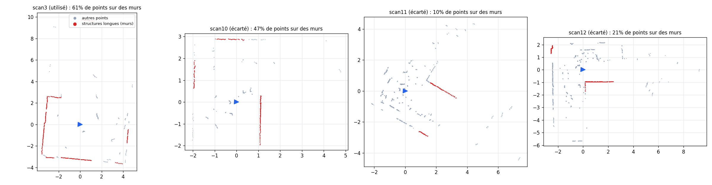

# Cartographie de la pièce — grid map et carte vectorielle

Généré le 03/11/2026 10:08.

## 1. Données

Scans utilisés : scan3, scan1, scan2, scan4, scan5, scan6, scan7, scan8, scan9. Scans écartés : scan10, scan11, scan12, scan13, scan14 (aucun recouvrement fiable avec la pièce).

Chaque scan est un tour du LD06 : environ 450 points (angle, distance) à 10 tr/s, plus de 1 000 points quand le lidar tourne plus lentement. Les scans ont été reçus au format Teleplot (`printScanTeleplot`), qui transmet x et y mais **pas l'intensité**.

## 2. Prétraitement (§2 du document)

- points à moins de 10 cm (boîtier, câbles) ou à plus de 10 m (précision dégradée) supprimés ;
- points **isolés** supprimés (moins de 2 voisins à moins de 15 cm) : reflets, poussières, mesures aberrantes ;
- **filtrage par intensité impossible ici** : l'intensité n'est pas transmise par le format Teleplot. Pour l'appliquer, il faut l'activer sur le robot (`ld06.enableFiltering(); ld06.setIntensityThreshold(seuil);`) ou envoyer les scans en CSV (`printScanCSV`), qui contient l'intensité.

Bilan : 9910 points bruts → 8593 points conservés.

| scan | points bruts | conservés | sur des murs (segments ≥ 60 cm) | utilisé |
|---|---|---|---|---|
| scan1 | 455 | 336 | 92% | oui |
| scan2 | 454 | 369 | 64% | oui |
| scan3 | 454 | 365 | 61% | oui |
| scan4 | 454 | 358 | 54% | oui |
| scan5 | 455 | 390 | 54% | oui |
| scan6 | 1050 | 986 | 80% | oui |
| scan7 | 687 | 503 | 69% | oui |
| scan8 | 1149 | 1036 | 81% | oui |
| scan9 | 455 | 386 | 52% | oui |
| scan10 | 454 | 337 | 47% | non |
| scan11 | 974 | 899 | 10% | non |
| scan12 | 1158 | 1095 | 21% | non |
| scan13 | 735 | 660 | 10% | non |
| scan14 | 976 | 873 | 27% | non |

## 3. Assemblage des scans (superposition dans un repère commun)

Les positions du robot n'ayant pas été mesurées, elles ont été retrouvées par **recalage** :

1. pour chaque paire de scans (A, B) et chaque rotation θ de 0 à 360° (pas de 2°), la translation qui superpose le mieux B sur A est cherchée par corrélation (FFT) entre les points de B et une grille floutée des points de A ;
2. la meilleure pose est affinée par **ICP** (Iterative Closest Point, cité dans le cours pour la détection de boucle) ;
3. le **recouvrement** (part des points de B à moins de 10 cm d'un point de A) mesure la qualité ; on garde les meilleures liaisons (arbre couvrant de recouvrement maximal) et on compose les poses depuis un scan de référence (pose 0, 0, 0).

Formule appliquée à chaque point : P_global = R(θ)·P_local + T(x, y).

| scan | x (m) | y (m) | θ (°) | recouvrement avec les autres scans |
|---|---|---|---|---|
| scan3 | 0.00 | 0.00 | 4.9 | 89% |
| scan1 | -2.13 | 2.55 | -13.5 | 93% |
| scan2 | 0.33 | 0.38 | 8.3 | 88% |
| scan4 | 0.61 | 0.23 | 175.0 | 88% |
| scan5 | 0.59 | -0.70 | 97.5 | 84% |
| scan6 | 1.07 | -0.58 | 88.8 | 91% |
| scan7 | -2.77 | -0.85 | 94.9 | 80% |
| scan8 | -2.63 | 3.46 | 87.1 | 85% |
| scan9 | -1.10 | -2.06 | -176.2 | 63% |

## 4. Grid map (carte d'occupation)

Cellules de 5 cm, log-odds : chaque rayon (Bresenham) rend libres les cellules traversées et occupée la cellule d'impact.

- surface libre : 76.6 m², occupée : 2.5 m²

## 5. Carte vectorielle (§3 et §4 du document)

- **segmentation** : rupture de cluster quand deux points successifs sont à plus de 20 cm ;
- **reconnaissance géométrique** : simplification polygonale (Douglas-Peucker, seuil 10 cm), puis droite des moindres carrés totaux sur chaque morceau ;
- **mise à jour** : un segment proche d'un segment existant (angle < 8°, écart latéral < 8 cm, trou < 20 cm) est **fusionné**, sinon **ajouté** ; chaque segment compte ses observations (confiance) ;
- **nettoyage** : segments de moins de 15 cm supprimés.

Résultat : 82 segments, dont 19 vus au moins 2 fois, 79.8 m de murs.

Fichier `carte_vectorielle.txt` : une ligne `x1,y1,x2,y2` par segment (format du document).

## 6. Scans écartés

Les scans scan10, scan11, scan12, scan13, scan14 n'ont pas pu être rattachés de façon fiable. Ils contiennent surtout de **petits amas de points** (pieds de chaises, de tables, objets bas, personnes) et **peu de structures longues** (murs) : le recalage n'a presque rien de commun et de stable à superposer. Une seule ligne droite commune ne suffit pas non plus : le scan peut « glisser » le long d'elle.

C'est typiquement le cas d'un lidar **posé au sol** : un lidar 2D ne voit que dans **un seul plan** (cours, §5), et à quelques centimètres du sol ce plan coupe surtout des pieds de meubles. Placé plus haut (sur une table, sur le robot), il voit les murs et les plateaux. Les personnes qui se déplacent pendant la capture ajoutent des points différents d'un scan à l'autre (objets mobiles, §5 du document).

## 7. Limites

- pas d'intensité : les reflets et surfaces sombres ne peuvent pas être filtrés par qualité ;
- les positions sont estimées par recalage : une pièce très symétrique ou très encombrée peut donner un recalage faux (c'est pourquoi certains scans ont été écartés) ;
- le lidar voit dans un seul plan (hauteur du capteur) : tables, chaises et pieds de meubles apparaissent comme des points ou de petits segments ;
- objets mobiles (personnes) : vus dans un seul scan, ils donnent des segments à 1 observation.
