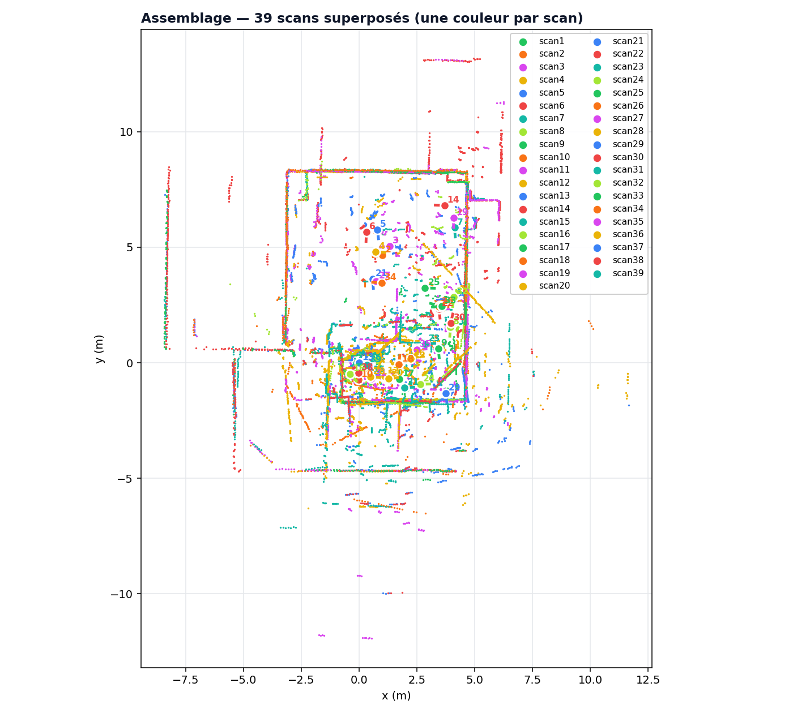
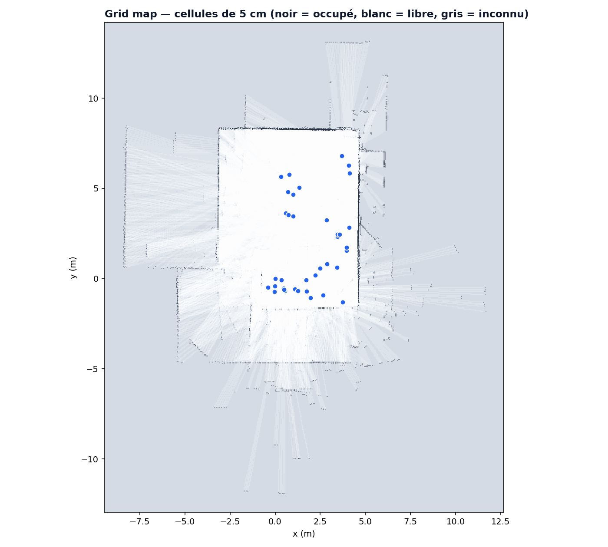
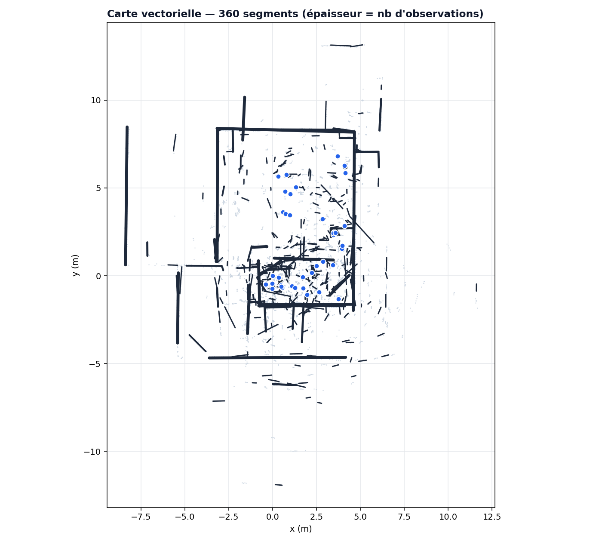

# Cartographie de la pièce — grid map et carte vectorielle

Généré le 03/11/2026 18:08.

## 1. Données

Scans utilisés : scan1, scan2, scan3, scan4, scan5, scan6, scan7, scan8, scan9, scan10, scan11, scan12, scan13, scan14, scan15, scan16, scan17, scan18, scan19, scan20, scan21, scan22, scan23, scan24, scan25, scan26, scan27, scan28, scan29, scan30, scan31, scan32, scan33, scan34, scan35, scan36, scan37, scan38, scan39. 

Chaque scan est un tour du LD06 : environ 450 points (angle, distance) à 10 tr/s, plus de 1 000 points quand le lidar tourne plus lentement. Les scans ont été reçus au format Teleplot (`printScanTeleplot`), qui transmet x et y mais **pas l'intensité**.

## 2. Prétraitement (§2 du document)

- points à moins de 10 cm (boîtier, câbles) ou à plus de 10 m (précision dégradée) supprimés ;
- points **isolés** supprimés (moins de 2 voisins à moins de 15 cm) : reflets, poussières, mesures aberrantes ;
- intensité < 50 supprimée.

Bilan : 23788 points bruts → 20404 points conservés.

| scan | points bruts | conservés | sur des murs (segments ≥ 60 cm) | utilisé |
|---|---|---|---|---|
| scan1 | 455 | 338 | 94% | oui |
| scan2 | 454 | 372 | 64% | oui |
| scan3 | 454 | 381 | 60% | oui |
| scan4 | 454 | 368 | 55% | oui |
| scan5 | 455 | 392 | 54% | oui |
| scan6 | 1050 | 986 | 80% | oui |
| scan7 | 687 | 503 | 69% | oui |
| scan8 | 1149 | 1036 | 81% | oui |
| scan9 | 455 | 386 | 52% | oui |
| scan10 | 454 | 341 | 46% | oui |
| scan11 | 974 | 909 | 10% | oui |
| scan12 | 1158 | 1106 | 21% | oui |
| scan13 | 735 | 661 | 10% | oui |
| scan14 | 976 | 873 | 27% | oui |
| scan15 | 870 | 820 | 18% | oui |
| scan16 | 304 | 279 | 74% | oui |
| scan17 | 305 | 212 | 50% | oui |
| scan18 | 304 | 204 | 38% | oui |
| scan19 | 302 | 208 | 41% | oui |
| scan20 | 792 | 710 | 15% | oui |
| scan21 | 758 | 656 | 51% | oui |
| scan22 | 766 | 686 | 95% | oui |
| scan23 | 784 | 738 | 40% | oui |
| scan24 | 304 | 254 | 64% | oui |
| scan25 | 693 | 610 | 85% | oui |
| scan26 | 454 | 352 | 93% | oui |
| scan27 | 454 | 361 | 75% | oui |
| scan28 | 455 | 349 | 28% | oui |
| scan29 | 454 | 366 | 29% | oui |
| scan30 | 453 | 375 | 68% | oui |
| scan31 | 454 | 361 | 34% | oui |
| scan32 | 455 | 353 | 66% | oui |
| scan33 | 455 | 345 | 91% | oui |
| scan34 | 453 | 344 | 83% | oui |
| scan35 | 1086 | 1015 | 20% | oui |
| scan36 | 1159 | 1106 | 32% | oui |
| scan37 | 455 | 343 | 23% | oui |
| scan38 | 454 | 345 | 14% | oui |
| scan39 | 455 | 360 | 38% | oui |

## 3. Assemblage des scans (superposition dans un repère commun)

Les positions du robot n'ayant pas été mesurées, elles ont été retrouvées par **recalage** :

1. pour chaque paire de scans (A, B) et chaque rotation θ de 0 à 360° (pas de 2°), la translation qui superpose le mieux B sur A est cherchée par corrélation (FFT) entre les points de B et une grille floutée des points de A ;
2. la meilleure pose est affinée par **ICP** (Iterative Closest Point, cité dans le cours pour la détection de boucle) ;
3. le **recouvrement** (part des points de B à moins de 10 cm d'un point de A) mesure la qualité ; on garde les meilleures liaisons (arbre couvrant de recouvrement maximal) et on compose les poses depuis un scan de référence (pose 0, 0, 0).

Formule appliquée à chaque point : P_global = R(θ)·P_local + T(x, y).

| scan | x (m) | y (m) | θ (°) | recouvrement avec les autres scans |
|---|---|---|---|---|
| scan1 | 3.48 | 2.47 | 165.6 | 99% |
| scan2 | 1.01 | 4.66 | -171.4 | 97% |
| scan3 | 1.33 | 5.04 | -175.0 | 93% |
| scan4 | 0.71 | 4.81 | -4.8 | 92% |
| scan5 | 0.79 | 5.77 | -83.5 | 88% |
| scan6 | 0.32 | 5.65 | -92.1 | 98% |
| scan7 | 4.13 | 5.85 | -86.0 | 99% |
| scan8 | 3.95 | 1.55 | -93.9 | 100% |
| scan9 | 3.42 | 0.62 | -84.3 | 96% |
| scan10 | -0.03 | -0.74 | 117.7 | 85% |
| scan11 | 0.55 | -0.68 | -62.9 | 94% |
| scan12 | 1.09 | -0.58 | -2.5 | 94% |
| scan13 | 0.00 | 0.00 | -34.1 | 98% |
| scan14 | 3.70 | 6.81 | 178.0 | 63% |
| scan15 | 0.47 | -0.53 | 0.8 | 95% |
| scan16 | -0.39 | -0.49 | -48.1 | 100% |
| scan17 | 1.75 | -0.72 | 95.9 | 98% |
| scan18 | 1.72 | -0.08 | 84.0 | 91% |
| scan19 | 4.08 | 6.26 | -89.8 | 91% |
| scan20 | 1.27 | -0.69 | 6.7 | 82% |
| scan21 | 0.58 | 3.62 | -85.2 | 91% |
| scan22 | 3.45 | 2.33 | -83.4 | 97% |
| scan23 | 2.87 | 0.81 | 4.5 | 96% |
| scan24 | 2.65 | -0.93 | 1.2 | 100% |
| scan25 | 2.85 | 3.23 | -1.3 | 100% |
| scan26 | 3.44 | 2.44 | -1.3 | 100% |
| scan27 | 0.74 | 3.53 | 4.8 | 97% |
| scan28 | 0.49 | -0.60 | -5.9 | 99% |
| scan29 | 3.75 | -1.31 | -83.4 | 85% |
| scan30 | 3.96 | 1.72 | 77.2 | 98% |
| scan31 | 1.96 | -1.07 | 0.4 | 84% |
| scan32 | 4.09 | 2.83 | -96.6 | 95% |
| scan33 | 3.57 | 2.44 | -175.8 | 100% |
| scan34 | 0.99 | 3.46 | 176.7 | 99% |
| scan35 | 2.50 | 0.57 | 4.3 | 93% |
| scan36 | 2.23 | 0.18 | 43.0 | 93% |
| scan37 | -0.01 | -0.43 | -82.3 | 99% |
| scan38 | -0.01 | -0.43 | -82.2 | 97% |
| scan39 | 0.34 | -0.09 | 175.8 | 87% |

## 4. Grid map (carte d'occupation)

Cellules de 5 cm, log-odds : chaque rayon (Bresenham) rend libres les cellules traversées et occupée la cellule d'impact.

- surface libre : 137.8 m², occupée : 3.9 m²

## 5. Carte vectorielle (§3 et §4 du document)

- **segmentation** : rupture de cluster quand deux points successifs sont à plus de 20 cm ;
- **reconnaissance géométrique** : simplification polygonale (Douglas-Peucker, seuil 10 cm), puis droite des moindres carrés totaux sur chaque morceau ;
- **mise à jour** : un segment proche d'un segment existant (angle < 8°, écart latéral < 8 cm, trou < 20 cm) est **fusionné**, sinon **ajouté** ; chaque segment compte ses observations (confiance) ;
- **nettoyage** : segments de moins de 15 cm supprimés.

Résultat : 360 segments, dont 70 vus au moins 2 fois, 236.4 m de murs.

Fichier `carte_vectorielle.txt` : une ligne `x1,y1,x2,y2` par segment (format du document).

## 7. Limites

- pas d'intensité : les reflets et surfaces sombres ne peuvent pas être filtrés par qualité ;
- les positions sont estimées par recalage : une pièce très symétrique ou très encombrée peut donner un recalage faux (c'est pourquoi certains scans ont été écartés) ;
- le lidar voit dans un seul plan (hauteur du capteur) : tables, chaises et pieds de meubles apparaissent comme des points ou de petits segments ;
- objets mobiles (personnes) : vus dans un seul scan, ils donnent des segments à 1 observation.
