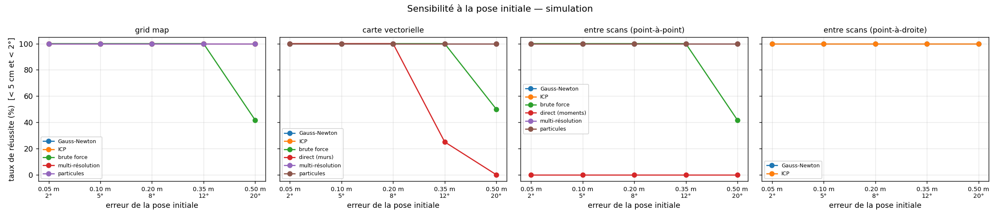
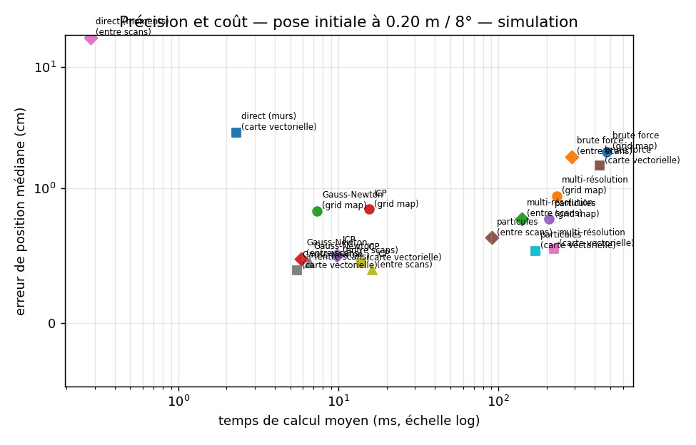
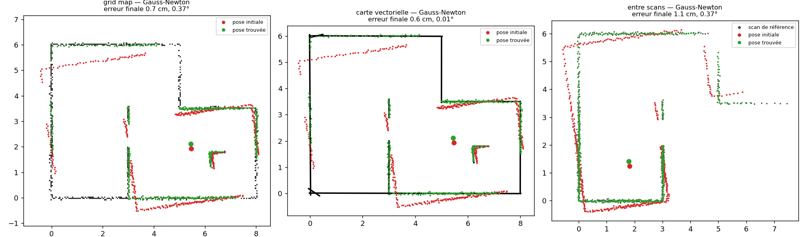
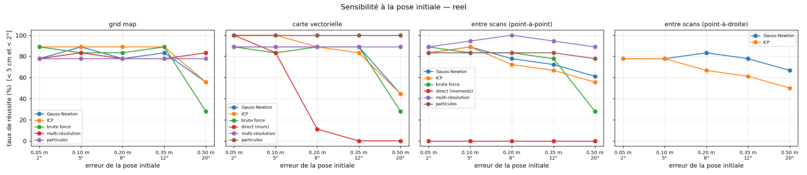
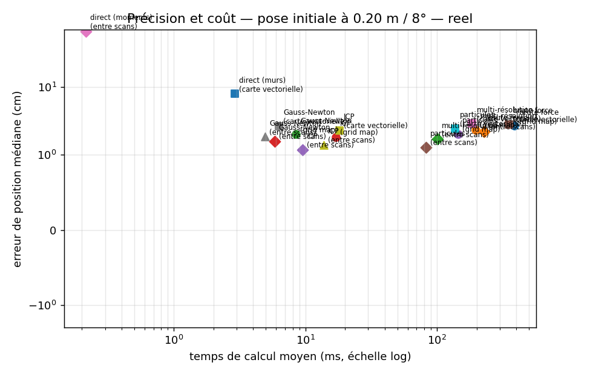
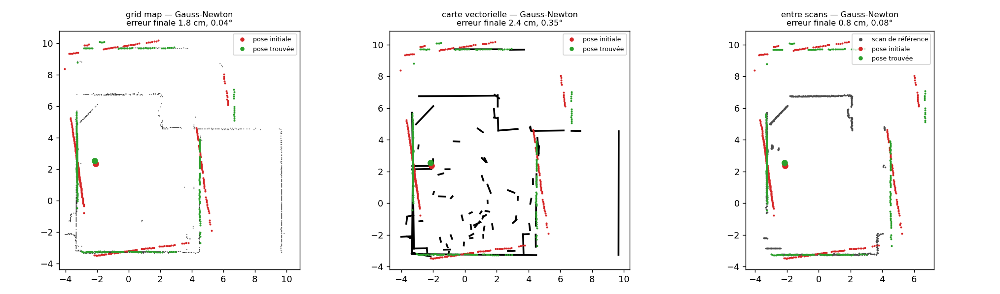

# Localisation par scan matching — évaluation chiffrée

Généré par `python -m carto evaluer` en 520 s.

## Protocole

- **Mêmes scans, mêmes poses initiales** pour toutes les méthodes : pour chaque scan et chaque niveau d'erreur initiale, la pose de départ est tirée une fois (graine fixe) puis donnée à chaque méthode.
- **Erreur de la pose initiale** : décalage de 75 à 100 % de d mètres dans une direction au hasard et de ±(75 à 100 % de a) degrés. Niveaux : 0.05 m / 2°, 0.10 m / 5°, 0.20 m / 8°, 0.35 m / 12°, 0.50 m / 20°.
- **Réussite** : erreur de position < 5 cm **et** erreur angulaire < 2°. 5 cm ≈ une cellule de la grid map et ≈ 1,5 × la précision du LD06 (30 mm, datasheet) ; 2° décale un mur situé à 3 m de 10 cm, au-delà la carte construite avec cette pose « bave ».
- **Fenêtre de recherche** des méthodes globales (brute force, multi-résolution) : ±0,50 m et ±15°, fixée à l'avance (sans connaître l'erreur réelle). Une erreur initiale de 20° est donc hors fenêtre : l'échec est attendu et montre la limite de ces méthodes.
- **Temps** : temps de calcul de la localisation seule (la référence — champ de distance, index — est construite une fois, avant), Python + numpy sur ce PC.

## Simulation (vérité terrain exacte)

Salle simulée en L (8 × 6 m, cloison, pilier) ; bruit des distances 30 mm, 2 % de mesures sans écho, 450 points/tour.
- grid map (cellules 5 cm) et carte vectorielle construites à partir de 4 scans simulés (pos1..pos4) ;
- scans à localiser sur ces cartes : poses tirées au hasard dans la salle (à plus de 40 cm des murs) ;
- entre scans : chaque scan pos1..pos4 est une référence ; scans à localiser pris à 30 cm et ±10° de sa position.

### Comparaison à erreur initiale 0.20 m / 8°

| référence | méthode | réussite | erreur position médiane / p90 | erreur angle médiane / p90 | précision si réussite | temps moyen | poses évaluées |
|---|---|---|---|---|---|---|---|
| grid map | Gauss-Newton | 100% (12) | 0.8 / 1.1 cm | 0.10 / 0.22° | 0.8 cm / 0.10° | 7 ms | 17 |
| grid map | ICP | 100% (12) | 0.8 / 1.2 cm | 0.10 / 0.21° | 0.8 cm / 0.10° | 15 ms | 52 |
| grid map | particules | 100% (12) | 0.8 / 2.1 cm | 0.18 / 0.26° | 0.8 cm / 0.18° | 207 ms | 6400 |
| grid map | multi-résolution | 100% (12) | 0.9 / 2.3 cm | 0.26 / 0.47° | 0.9 cm / 0.26° | 230 ms | 7173 |
| grid map | brute force | 100% (12) | 2.0 / 3.2 cm | 0.39 / 0.86° | 2.0 cm / 0.39° | 477 ms | 14196 |
| carte vectorielle | direct (murs) | 100% (12) | 2.9 / 3.8 cm | 0.27 / 0.57° | 2.9 cm / 0.27° | 2 ms | 1 |
| carte vectorielle | Gauss-Newton | 100% (12) | 0.4 / 0.6 cm | 0.06 / 0.09° | 0.4 cm / 0.06° | 6 ms | 12 |
| carte vectorielle | ICP | 100% (12) | 0.4 / 0.6 cm | 0.05 / 0.09° | 0.4 cm / 0.05° | 14 ms | 45 |
| carte vectorielle | particules | 100% (12) | 0.5 / 0.8 cm | 0.06 / 0.17° | 0.5 cm / 0.06° | 170 ms | 6400 |
| carte vectorielle | multi-résolution | 100% (12) | 0.6 / 1.3 cm | 0.13 / 0.17° | 0.6 cm / 0.13° | 222 ms | 7173 |
| carte vectorielle | brute force | 100% (12) | 1.5 / 2.6 cm | 0.39 / 0.67° | 1.5 cm / 0.39° | 429 ms | 14196 |
| entre scans (point-à-point) | direct (moments) | 0% (12) | 17.6 / 20.7 cm | 4.96 / 7.40° | — | 0 ms | 1 |
| entre scans (point-à-point) | Gauss-Newton | 100% (12) | 0.5 / 0.9 cm | 0.13 / 0.28° | 0.5 cm / 0.13° | 6 ms | 12 |
| entre scans (point-à-point) | ICP | 100% (12) | 0.5 / 1.0 cm | 0.15 / 0.40° | 0.5 cm / 0.15° | 10 ms | 33 |
| entre scans (point-à-point) | particules | 100% (12) | 0.6 / 1.0 cm | 0.08 / 0.24° | 0.6 cm / 0.08° | 91 ms | 6400 |
| entre scans (point-à-point) | multi-résolution | 100% (12) | 0.8 / 1.5 cm | 0.14 / 0.27° | 0.8 cm / 0.14° | 139 ms | 7173 |
| entre scans (point-à-point) | brute force | 100% (12) | 1.8 / 2.3 cm | 0.28 / 0.50° | 1.8 cm / 0.28° | 286 ms | 14196 |
| entre scans (point-à-droite) | Gauss-Newton | 100% (12) | 0.5 / 0.6 cm | 0.06 / 0.17° | 0.5 cm / 0.06° | 7 ms | 11 |
| entre scans (point-à-droite) | ICP | 100% (12) | 0.4 / 0.6 cm | 0.08 / 0.12° | 0.4 cm / 0.08° | 16 ms | 57 |

### Sensibilité à la pose initiale (taux de réussite)

| référence | méthode | 0.05 m / 2° | 0.10 m / 5° | 0.20 m / 8° | 0.35 m / 12° | 0.50 m / 20° |
|---|---|---|---|---|---|---|
| grid map | Gauss-Newton | 100% | 100% | 100% | 100% | 100% |
| grid map | ICP | 100% | 100% | 100% | 100% | 100% |
| grid map | brute force | 100% | 100% | 100% | 100% | 42% |
| grid map | multi-résolution | 100% | 100% | 100% | 100% | 100% |
| grid map | particules | 100% | 100% | 100% | 100% | 100% |
| carte vectorielle | Gauss-Newton | 100% | 100% | 100% | 100% | 100% |
| carte vectorielle | ICP | 100% | 100% | 100% | 100% | 100% |
| carte vectorielle | brute force | 100% | 100% | 100% | 100% | 50% |
| carte vectorielle | direct (murs) | 100% | 100% | 100% | 25% | 0% |
| carte vectorielle | multi-résolution | 100% | 100% | 100% | 100% | 100% |
| carte vectorielle | particules | 100% | 100% | 100% | 100% | 100% |
| entre scans (point-à-point) | Gauss-Newton | 100% | 100% | 100% | 100% | 100% |
| entre scans (point-à-point) | ICP | 100% | 100% | 100% | 100% | 100% |
| entre scans (point-à-point) | brute force | 100% | 100% | 100% | 100% | 42% |
| entre scans (point-à-point) | direct (moments) | 0% | 0% | 0% | 0% | 0% |
| entre scans (point-à-point) | multi-résolution | 100% | 100% | 100% | 100% | 100% |
| entre scans (point-à-point) | particules | 100% | 100% | 100% | 100% | 100% |
| entre scans (point-à-droite) | Gauss-Newton | 100% | 100% | 100% | 100% | 100% |
| entre scans (point-à-droite) | ICP | 100% | 100% | 100% | 100% | 100% |

## Scans réels de la salle

Session `salle_2026-11-02_18h31`, scans 1 à 9 (les scans 10 à 14, lidar posé au sol, ne voient presque pas les murs).
- **Pose de référence** : pose obtenue à l'assemblage (recalage global + ICP). Les positions n'ont pas été mesurées au mètre sur le robot pendant la capture : la référence est donc elle-même une estimation.
- grid map et carte vectorielle construites **sans** le scan testé (sinon le scan se retrouverait dans sa propre carte) ;
- entre scans : chaque scan contre le scan dont la position assemblée est la plus proche.

### Incertitude des poses de référence

Écart-type estimé par approximation de Laplace (Σ = s² (JᵀWJ)⁻¹, s² = variance des distances point → carte vectorielle construite sans ce scan) :

| scan | σx | σy | σθ |
|---|---|---|---|
| scan1 | 2.0 mm | 3.9 mm | 0.062° |
| scan2 | 3.3 mm | 3.6 mm | 0.068° |
| scan3 | 3.2 mm | 3.3 mm | 0.072° |
| scan4 | 3.7 mm | 4.5 mm | 0.080° |
| scan5 | 5.0 mm | 4.2 mm | 0.093° |
| scan6 | 2.2 mm | 2.0 mm | 0.037° |
| scan7 | 4.2 mm | 6.5 mm | 0.099° |
| scan8 | 1.6 mm | 2.6 mm | 0.042° |
| scan9 | 6.1 mm | 5.1 mm | 0.165° |

Moyenne : σx = 3.5 mm, σy = 4.0 mm, σθ = 0.080°. C'est une borne optimiste (bruit supposé indépendant) : l'incertitude réelle est surtout due aux erreurs de l'assemblage lui-même et aux objets déplacés entre scans, de l'ordre du centimètre et du demi-degré (écart entre méthodes convergées ci-dessous). Une pose mesurée au mètre ruban et au rapporteur serait connue à environ ±2 cm et ±2°, donc moins précise que les méthodes testées.

### Écart à la référence scan par scan

Erreur de position médiane sur toutes les méthodes itératives et toutes les poses initiales (un scan dont toutes les méthodes s'écartent de la même façon a probablement une pose de référence décalée) :

| scan | grid map | carte vectorielle | entre scans (point-à-point) | entre scans (point-à-droite) |
|---|---|---|---|---|
| scan1 | 2.0 cm | 2.8 cm | 1.3 cm | 1.8 cm |
| scan2 | 1.5 cm | 0.9 cm | 1.1 cm | 1.0 cm |
| scan3 | 1.2 cm | 1.1 cm | 0.6 cm | 0.4 cm |
| scan4 | 1.6 cm | 2.1 cm | 1.0 cm | 1.8 cm |
| scan5 | 5.6 cm | 3.8 cm | 1.9 cm | 0.9 cm |
| scan6 | 1.0 cm | 2.6 cm | 1.0 cm | 2.1 cm |
| scan7 | 5.2 cm | 4.5 cm | 5.2 cm | 7.1 cm |
| scan8 | 3.4 cm | 2.7 cm | 2.4 cm | 2.1 cm |
| scan9 | 3.3 cm | 3.1 cm | 5.3 cm | 7.0 cm |

### Comparaison à erreur initiale 0.20 m / 8°

| référence | méthode | réussite | erreur position médiane / p90 | erreur angle médiane / p90 | précision si réussite | temps moyen | poses évaluées |
|---|---|---|---|---|---|---|---|
| grid map | Gauss-Newton | 78% (18) | 2.0 / 5.6 cm | 0.22 / 0.69° | 1.7 cm / 0.16° | 8 ms | 17 |
| grid map | ICP | 89% (18) | 1.8 / 4.5 cm | 0.27 / 0.59° | 1.5 cm / 0.19° | 17 ms | 57 |
| grid map | particules | 78% (18) | 2.0 / 5.4 cm | 0.32 / 0.61° | 1.7 cm / 0.32° | 145 ms | 6400 |
| grid map | multi-résolution | 78% (18) | 2.3 / 5.2 cm | 0.26 / 0.68° | 2.1 cm / 0.26° | 197 ms | 7173 |
| grid map | brute force | 83% (18) | 2.7 / 5.7 cm | 0.38 / 0.90° | 2.6 cm / 0.34° | 388 ms | 14196 |
| carte vectorielle | direct (murs) | 11% (18) | 8.0 / 12.8 cm | 0.21 / 1.13° | 3.9 cm / 0.11° | 3 ms | 1 |
| carte vectorielle | Gauss-Newton | 89% (18) | 2.7 / 6.2 cm | 0.30 / 0.55° | 2.6 cm / 0.27° | 6 ms | 14 |
| carte vectorielle | ICP | 89% (18) | 2.3 / 5.9 cm | 0.26 / 0.63° | 2.2 cm / 0.25° | 18 ms | 59 |
| carte vectorielle | particules | 100% (18) | 2.4 / 4.0 cm | 0.27 / 0.37° | 2.4 cm / 0.27° | 138 ms | 6400 |
| carte vectorielle | multi-résolution | 89% (18) | 2.9 / 4.5 cm | 0.31 / 0.58° | 2.6 cm / 0.25° | 186 ms | 7173 |
| carte vectorielle | brute force | 89% (18) | 2.8 / 5.1 cm | 0.35 / 0.60° | 2.7 cm / 0.34° | 353 ms | 14196 |
| entre scans (point-à-point) | direct (moments) | 0% (18) | 67.1 / 187.6 cm | 12.15 / 44.25° | — | 0 ms | 1 |
| entre scans (point-à-point) | Gauss-Newton | 78% (18) | 1.6 / 6.2 cm | 0.44 / 0.83° | 1.0 cm / 0.44° | 6 ms | 18 |
| entre scans (point-à-point) | ICP | 72% (18) | 1.2 / 22.3 cm | 0.25 / 1.75° | 1.1 cm / 0.23° | 10 ms | 38 |
| entre scans (point-à-point) | particules | 83% (18) | 1.3 / 5.1 cm | 0.16 / 0.43° | 1.1 cm / 0.16° | 83 ms | 6400 |
| entre scans (point-à-point) | multi-résolution | 100% (18) | 1.7 / 4.5 cm | 0.24 / 0.65° | 1.7 cm / 0.24° | 101 ms | 7173 |
| entre scans (point-à-point) | brute force | 83% (18) | 2.2 / 5.4 cm | 0.28 / 0.63° | 1.9 cm / 0.32° | 229 ms | 14196 |
| entre scans (point-à-droite) | Gauss-Newton | 83% (18) | 1.8 / 7.0 cm | 0.16 / 0.48° | 1.8 cm / 0.24° | 5 ms | 14 |
| entre scans (point-à-droite) | ICP | 67% (18) | 1.4 / 27.4 cm | 0.22 / 3.31° | 1.0 cm / 0.19° | 14 ms | 56 |

### Sensibilité à la pose initiale (taux de réussite)

| référence | méthode | 0.05 m / 2° | 0.10 m / 5° | 0.20 m / 8° | 0.35 m / 12° | 0.50 m / 20° |
|---|---|---|---|---|---|---|
| grid map | Gauss-Newton | 78% | 89% | 78% | 83% | 56% |
| grid map | ICP | 89% | 89% | 89% | 89% | 56% |
| grid map | brute force | 89% | 83% | 83% | 89% | 28% |
| grid map | multi-résolution | 78% | 83% | 78% | 78% | 83% |
| grid map | particules | 78% | 78% | 78% | 78% | 78% |
| carte vectorielle | Gauss-Newton | 89% | 89% | 89% | 89% | 44% |
| carte vectorielle | ICP | 100% | 100% | 89% | 83% | 44% |
| carte vectorielle | brute force | 89% | 83% | 89% | 89% | 28% |
| carte vectorielle | direct (murs) | 100% | 83% | 11% | 0% | 0% |
| carte vectorielle | multi-résolution | 89% | 89% | 89% | 89% | 89% |
| carte vectorielle | particules | 100% | 100% | 100% | 100% | 100% |
| entre scans (point-à-point) | Gauss-Newton | 83% | 89% | 78% | 72% | 61% |
| entre scans (point-à-point) | ICP | 83% | 89% | 72% | 67% | 56% |
| entre scans (point-à-point) | brute force | 89% | 83% | 83% | 78% | 28% |
| entre scans (point-à-point) | direct (moments) | 0% | 0% | 0% | 0% | 0% |
| entre scans (point-à-point) | multi-résolution | 89% | 94% | 100% | 94% | 89% |
| entre scans (point-à-point) | particules | 83% | 83% | 83% | 83% | 78% |
| entre scans (point-à-droite) | Gauss-Newton | 78% | 78% | 83% | 78% | 67% |
| entre scans (point-à-droite) | ICP | 78% | 78% | 67% | 61% | 50% |

## Fichiers

- `resultats.csv` : une ligne par essai (séparateur `;`, virgule décimale : s'ouvre dans Excel) ;
- `sensibilite_*.png`, `precision_temps_*.png`, `exemples_*.png` : figures du rapport.
